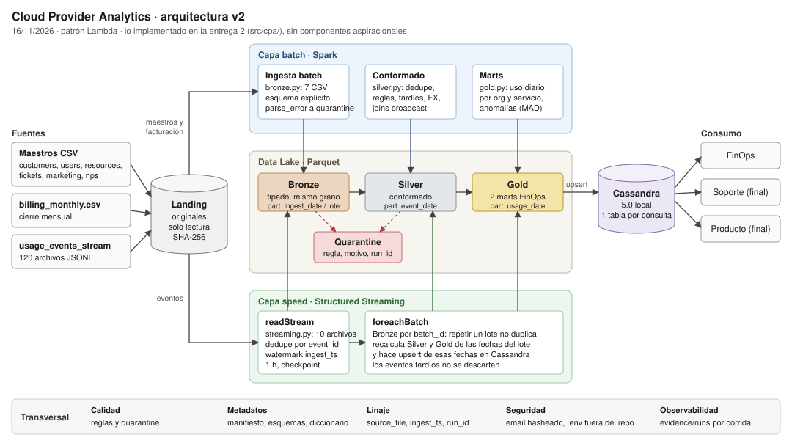

# Cloud Provider Analytics · Entrega 2: implementación técnica

Big Data (72.80) · ITBA · 2.º cuatrimestre 2026 · Prof. Diego Mosquera

Grupo 9: Nicolás Martín Amarilla Díaz, Francisco Cattaneo, Juan Manuel Rilo y Gonzalo Ruiz Camauer · 16/11/2026 · versión entregada: tag `entrega-2`

El pipeline corre de punta a punta con un comando, `make pipeline`: Landing → Bronze → Silver → Gold → Cassandra, con la ingesta batch de los maestros y el streaming de eventos. En una notebook de 8 núcleos tarda unos 4 minutos. Todos los números de este documento salen de esa corrida y de los scripts de `scripts/`; las tablas quedan en `evidence/02_entrega/` y cada corrida deja su registro en `evidence/runs/`.

| Punto del checklist (anexo 9.2) | Dónde está |
|---|---|
| Correcciones de la primera entrega incorporadas | [Sección 1](#1-qué-cambió-desde-la-entrega-1) y [`plan_de_correcciones.md`](plan_de_correcciones.md) |
| Arquitectura actualizada | [Sección 2](#2-arquitectura-implementada) |
| Tres maestros batch en Bronze | [Sección 3](#3-qué-hace-cada-capa): los siete CSV |
| Streaming con esquema, watermark, dedupe, late data y checkpoint | [Sección 3](#3-qué-hace-cada-capa), experimentos E1 y E2 |
| Silver para eventos y al menos un maestro | [Sección 3](#3-qué-hace-cada-capa): eventos y cuatro maestros |
| Tres features calculadas | Seis en el mart: costo, requests, horas de CPU, GB-hora, tokens y carbono |
| Tres reglas de calidad y quarantine | [Sección 3](#3-qué-hace-cada-capa) y [`gobierno.md`](gobierno.md) |
| Mart `org_daily_usage_by_service` en Gold | [Sección 3](#3-qué-hace-cada-capa) |
| Keyspace y tabla Cassandra poblada | [Sección 5](#5-cassandra) |
| Dos consultas CQL con resultados | [Sección 5](#5-cassandra) y `evidence/02_entrega/consultas_cql.txt` |
| Idempotencia demostrada | Experimento [E6](#e6-idempotencia) |
| README Quickstart, logs y evidencias | [`README.md`](../README.md), `evidence/` |
| Backlog final priorizado | [`backlog.md`](backlog.md) |

## 1. Qué cambió desde la entrega 1

La devolución de la entrega 1 no tuvo correcciones obligatorias. Recomendó mantener la actitud experimental: decisión, hipótesis, ejecución, evidencia y conclusión. Ese es el formato de la sección 4: cada decisión nueva de esta entrega se probó con datos antes de quedar.

Lo que cambió en el diseño:

- **Serving (D-09, cerrada).** Cassandra 5.0.9 local, con el binario de Apache. No depende de cuentas ni de la red.
- **Anomalías (D-11, cerrada).** El score se calcula al grano del mart, contra la historia de la misma organización y servicio.
- **Decisiones nuevas.** D-13 (foreachBatch idempotente), D-14 (una tabla de Cassandra por consulta) y D-15 (la capa speed recalcula las fechas que toca cada lote).

## 2. Arquitectura implementada



Cada caja del diagrama es un módulo de `src/cpa/`:

| Módulo | Responsabilidad |
|---|---|
| `bronze.py` | Los siete CSV a Bronze |
| `streaming.py` | Eventos a Bronze con Structured Streaming, y el foreachBatch de la capa speed |
| `silver.py` | Reglas, deduplicación, tardíos, tipo de cambio, joins |
| `gold.py` | El mart diario y el de anomalías |
| `serving.py` | Carga y consultas en Cassandra |
| `pipeline.py` | Encadena todo en el orden de la arquitectura Lambda |

Ningún componente del diagrama es aspiracional: Soporte y Producto figuran como consumo de la entrega final.

## 3. Qué hace cada capa

| Capa | Entra | Sale | Quarantine | Partición |
|---|---|---|---|---|
| Bronze batch (7 CSV) | 4.112 filas | 4.112 | 0 | `ingest_date` (facturación por `month`) |
| Bronze streaming | 43.200 eventos, 120 archivos | 43.200 en 12 micro-lotes | 0 | `ingest_date` / `batch_id` |
| Silver de eventos | 43.200 | 42.989 | 211 (`costo_negativo`) | `event_date` |
| Silver de facturación | 240 | 227 | 13 (`subtotal_negativo`) | `month` |
| Silver de customers, resources y users | 80 / 400 / 800 | 80 / 400 / 800 | 0 | sin partición, versión vigente |
| Gold `org_daily_usage_by_service` | 42.989 eventos | 11.050 filas (org × día × servicio) | | `usage_date` |
| Gold `cost_anomaly_mart` | 11.050 | 11.050, 63 días marcados | | `usage_date` |
| Cassandra | 11.050 | 11.050 en cada tabla, 0 errores | | `org_id` |

En cada fila de la tabla, lo que entra es igual a lo que sale más lo que va a quarantine, y el registro de la corrida lo controla. Gold suma 148.351,58 USD, lo mismo que Silver y lo mismo que el flujo de referencia de la entrega 1.

**Streaming.** Lee el directorio con el esquema explícito, 10 archivos por lote. El watermark es de 1 hora sobre `ingest_ts`, con `dropDuplicatesWithinWatermark(["event_id"])` y checkpoint propio. El foreachBatch escribe Bronze en la partición de su lote y recalcula Silver y Gold de las fechas que tocó. Los 12 lotes tocan las 60 fechas: los archivos vienen desordenados. A partir del segundo lote casi todos los eventos son tardíos respecto de lo ya visto: 39.375 de 42.989. No se descarta ninguno; quedan marcados con `is_late` y se cuentan en `late_events` del mart.

**Reglas de calidad (Silver).** Con quarantine:
- `event_id` nulo o repetido;
- costo menor a -0,01;
- `value` no numérico;
- recurso inexistente o que no coincide con la organización o el servicio del evento;
- subtotal negativo en facturación.

Con flag, sin sacar la fila:
- `unit` completada desde `metric` (2.033 eventos);
- costo entre -0,01 y 0, tomado como redondeo;
- tipo de cambio de USD forzado a 1 (150 facturas);
- créditos nulos tomados como 0 (133);
- NPS fuera de rango (1).

Cada fila en quarantine guarda la regla, el motivo, el registro original en JSON y el `run_id`.

**Joins de enriquecimiento.** Los eventos se cruzan con `resources`, para validar recurso, servicio y organización, y con `customers_orgs`, para sumar `plan_tier` e `industry`. Las dos dimensiones son chicas y van por broadcast.

**Analítica.** `cost_anomaly_mart` calcula un z robusto (MAD) sobre log(1 + costo diario), contra la historia de cada organización y servicio. Marca un día cuando el score supera 3,5 y hay al menos 14 días de historia. Los 10 días con mayor score están en `evidence/02_entrega/anomalias_top10.csv`.

## 4. Experimentos

### E1. Duplicados: dos capas de deduplicación

**Decisión.** Deduplicar en streaming con un watermark de 1 hora de llegada (D-06) y volver a deduplicar en Silver por `event_id`.

**Hipótesis.** Un archivo reenviado dentro de la hora se descarta en streaming. Uno que llega más tarde pasa a Bronze, pero la regla de Silver lo atrapa.

**Ejecución.** Se copió Landing de eventos, se agregó un reenvío de `events_part_0000` (360 eventos) y se corrió el streaming dos veces: con 1 hora y con 1 segundo de watermark. El segundo caso simula un reenvío que llega fuera de la ventana.

**Evidencia** (`exp_e1_duplicados.csv`):

| Escenario | Descartados en streaming | Filas en Bronze | Duplicados en quarantine de Silver | Filas en Silver |
|---|---|---|---|---|
| Reenvío dentro de la ventana | 360 | 43.200 | 0 | 42.989 |
| Reenvío fuera de la ventana | 0 | 43.560 | 360 | 42.989 |

**Conclusión.** Silver queda igual en los dos casos. El streaming saca el duplicado típico con estado acotado, y Silver cubre el resto.

Un hallazgo: el estado de la deduplicación crece hasta 43.200 filas y no baja (`streaming_progreso.csv`). La corrida completa dura unos minutos, así que con 1 hora de watermark sobre la hora de llegada no vence nada. En producción, con el streaming corriendo de forma continua, el estado guardaría la última hora de llegadas. Con el supuesto de escala del diseño (216 millones de eventos por día) eso son unos 9 millones de claves, y ahí conviene el state store en RocksDB que recomienda la clase.

### E2. El patrón de clase sobre estos datos

**Decisión.** No agregar por fecha de evento en streaming. La capa speed recalcula las fechas que toca cada lote y la capa batch deja la cifra definitiva (D-15).

**Hipótesis.** El patrón que se vio en clase (watermark sobre la fecha del evento, ventana de un día, modo append) pierde la mayoría de los eventos, porque cada archivo trae los 60 días.

**Ejecución.** Se corrió ese patrón sobre los mismos 120 archivos, con 10 archivos por lote, con 1 hora y con 7 días de watermark, y se comparó contra Gold.

**Evidencia** (`exp_e2_patron_de_clase.csv`):

| Configuración | Filas en Gold | Eventos contados | Perdidos | Costo |
|---|---|---|---|---|
| Watermark 1 hora, ventana de 1 día, append | 5.332 | 7.045 | 83,6% | 24.936,17 USD |
| Watermark 7 días, ventana de 1 día, append | 4.683 | 6.182 | 85,6% | 22.154,97 USD |
| Lambda de este proyecto | 11.050 | 42.989 | 0% | 148.351,58 USD |

**Conclusión.** Agrandar el watermark no alcanza. Con 7 días el watermark descarta menos eventos (26.811 contra 30.373), pero se pierde más igual: en modo append, las ventanas de la última semana nunca se cierran y no se emiten. El patrón es correcto cuando los eventos llegan casi en orden; con estos datos, recalcular por fecha es la única forma de no perder nada.

### E3. Umbral de anomalías

**Decisión.** z robusto sobre el logaritmo del costo diario, contra la historia de cada organización y servicio, con umbral 3,5 (D-11).

**Hipótesis.** El umbral marca pocos días y el resultado no cambia mucho si se mueve medio punto.

**Evidencia** (`exp_e3_umbral_anomalias.csv`): de 11.050 días,

| Umbral | Días marcados | Organizaciones |
|---|---|---|
| 2,5 | 99 | 47 |
| 3 | 83 | 46 |
| 3,5 | 63 | 38 |
| 4 | 47 | 33 |
| 5 | 20 | 16 |

Con una línea base por servicio, que compara a cada organización con todas las demás, se marcan 59 días y 46 coinciden con los del criterio elegido.

**Conclusión.** Con 3,5 queda marcado el 0,57% de los días. Los dos criterios ven casi lo mismo, pero la línea base propia no marca a una organización grande por gastar más que las chicas. El dataset no trae etiquetas de anomalía, así que no se puede medir precisión: el umbral queda como parámetro.

### E4. Archivos por zona

**Decisión.** Particiones de la sección 7.3 del diseño y `repartition` por la columna de partición antes de escribir (D-07).

**Evidencia** (`exp_e4_archivos_por_zona.csv`):

| Tabla | Archivos | Tamaño por archivo |
|---|---|---|
| Bronze de eventos | 12, uno por micro-lote | 165 KB |
| Silver de eventos | 60, uno por fecha | 46 KB |
| Gold diario | 60 | 11 KB |
| Quarantine de eventos | 58 | 4,5 KB |

**Conclusión.** Ninguna tabla tiene más de un archivo por partición. Gold y quarantine quedan en archivos chicos porque la muestra es chica; al volumen del supuesto de escala, cada partición diaria tendría cientos de megabytes. Compactar quarantine queda en el backlog.

### E5. Cassandra contra el lake

**Hipótesis.** Las dos consultas sobre Cassandra devuelven lo mismo que Gold en Parquet.

**Evidencia** (`exp_e5_serving_vs_lake.csv`):
- Consulta 1: 34 filas y 480,5494 USD en los dos lados.
- Consulta 2: los seis servicios con el mismo costo hasta el cuarto decimal.

**Conclusión.** La carga no pierde ni altera filas.

### E6. Idempotencia

**Decisión.** Toda escritura es idempotente: overwrite dinámico de particiones en el lake, una partición por micro-lote en Bronze de eventos (D-13) y upsert por clave primaria en Cassandra.

**Hipótesis.** Re-ejecutar el pipeline no cambia ningún conteo, ni siquiera después de borrar el checkpoint, que es el error que la clase marca como causa de duplicados.

**Ejecución.** `make idempotencia` toma 21 conteos: las 19 tablas de Bronze, Silver, Gold, quarantine y Cassandra, el costo total de Gold y los `event_id` distintos de Silver. Después corre el pipeline completo dos veces, la segunda con el checkpoint borrado, y vuelve a contar.

**Evidencia** (`idempotencia.csv`). Los 21 conteos dan lo mismo en los tres momentos.
- **Con el mismo checkpoint:** el streaming no procesa ningún lote.
- **Sin checkpoint:** vuelve a procesar los 12 lotes, pero cada uno cae en su misma partición `batch_id` y Bronze sigue en 43.200 filas.

**Conclusión.** El pipeline se puede reprocesar sin duplicar. Si el reproceso sin checkpoint cayera otro día, Bronze tendría las dos copias en distintas `ingest_date`. Silver las separa por `event_id`, como en E1.

## 5. Cassandra

Keyspace `cloud_analytics`, con dos tablas query-first cargadas desde el mismo mart (`cql/schema.cql`, D-14):

| Tabla | Clave primaria | Consulta |
|---|---|---|
| `org_daily_usage_by_service` | `((org_id), usage_date, service)` | 1. Costos y requests diarios por organización y servicio en un rango de fechas |
| `org_service_daily_cost` | `((org_id), service, usage_date)` | 2. Top-N servicios por costo acumulado en los últimos 14 días |

Las dos consultas están en `cql/queries.cql`. La salida completa de cqlsh está en `evidence/02_entrega/consultas_cql.txt`. Ninguna usa `ALLOW FILTERING`: cada una lee una sola partición. La organización de ejemplo es la de mayor costo total.

```sql
SELECT service, SUM(daily_cost_usd) AS cost_last_14d, COUNT(*) AS days
FROM cloud_analytics.org_service_daily_cost
WHERE org_id = 'org_53lc58dr'
  AND service IN ('analytics', 'compute', 'database', 'genai', 'networking', 'storage')
  AND usage_date >= '2025-08-18'
GROUP BY service;
```

| service | cost_last_14d | days |
|---|---|---|
| analytics | 282,0746 | 13 |
| genai | 271,2743 | 11 |
| compute | 237,4770 | 12 |
| database | 182,7793 | 14 |
| storage | 36,2660 | 11 |
| networking | 15,4267 | 7 |

Sin el `IN`, Cassandra rechaza la consulta: no deja restringir `usage_date` sin restringir antes `service`, que está antes en el clustering. CQL tampoco ordena por un agregado. Con seis servicios, el top-N se ordena al leer; la tabla de arriba ya está ordenada.

La carga usa el driver de Python, porque el conector de Spark para Cassandra no tiene versión para Spark 4. Inserta 11.050 filas por tabla en unos 4 segundos, con sentencias preparadas en paralelo.

## 6. Gobierno, pruebas y reproducibilidad

- **Gobierno preliminar:** controles, diccionario de datos de Silver y Gold, linaje columna por columna, responsabilidades y acceso, en [`gobierno.md`](gobierno.md).
- **Configuración:** externa en `config/settings.toml`, con umbrales de calidad y anomalías, conexión a Cassandra y tamaño de micro-lote. Las credenciales irían en `.env`, que no se versiona.
- **Registro de corridas:** cada corrida deja su JSON en `evidence/runs/` con conteos por tabla y el resultado de cada control. Si un control falla, el paso termina con error.
- **Tests:** 10 (`make test`):
  - reglas de calidad y quarantine;
  - las reglas de facturación de D-10;
  - el cálculo de tardíos;
  - el cast con fallback;
  - el control de Landing.
- **Reproducibilidad:** desde un entorno limpio son `make setup`, Cassandra con tres comandos y `make pipeline` (README, Quickstart). `make reset` vuelve el lake al estado inicial sin tocar Landing. En Colab, el notebook [`02_pipeline_entrega2.ipynb`](../notebooks/02_pipeline_entrega2.ipynb) corre el pipeline sin serving hasta Gold y muestra los resultados.

## 7. Limitaciones y lo que sigue

- **Cassandra local:** la demo de serving no corre en Colab. Para la defensa remota quedan la salida de cqlsh y la comparación contra el lake.
- **Estado del streaming:** en una corrida corta, el estado de la deduplicación no llega a vencer (E1).
- **Alcance de Gold:** por ahora tiene los marts de FinOps de esta entrega. Revenue, tickets y GenAI, con sus consultas 3 a 5, están priorizados en el [backlog](backlog.md) para la entrega final.
